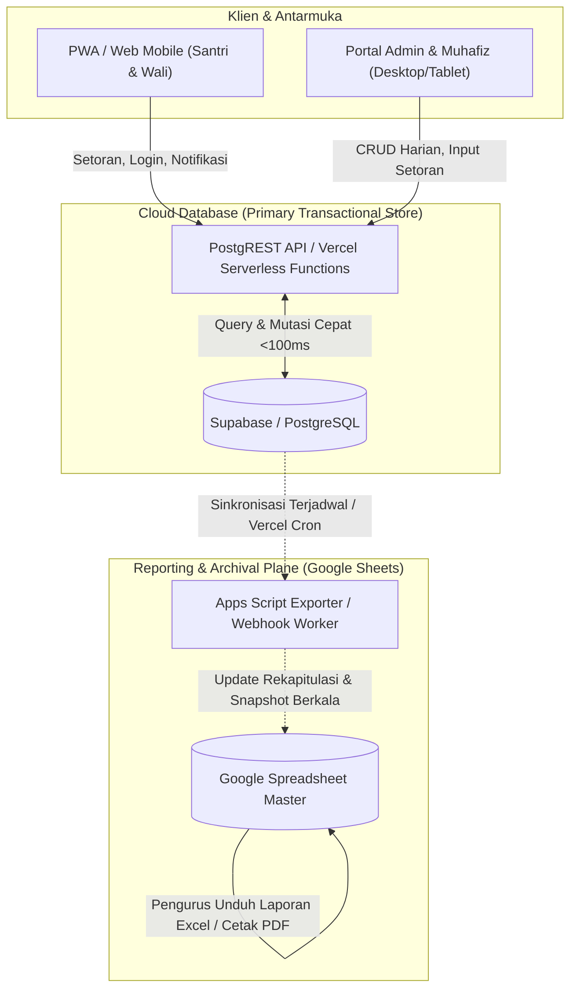

# Blueprin Arsitektur: Transisi Data Transaksional ke Cloud Database
**Portal Terpadu PPTQ Asnawiyyah Pilangwetan**
*Dokumen Arsitektur & Rencana Skalabilitas Jangka Panjang (Fase 4)*

---

## 1. Eksekutif Ringkasan & Problem Statement

Saat ini, seluruh operasional sistem PPTQ Asnawiyyah menggunakan **Google Sheets** sebagai *primary data store* yang diakses melalui endpoint Google Apps Script (`doPost` / `doGet`). 

Arsitektur ini sangat efisien dan bebas biaya di fase awal, namun memiliki keterbatasan fundamental untuk data transaksional berkecepatan tinggi (*high-frequency transactional data*):

### Batasan Google Sheets untuk Data Transaksional:
1. **Volume Pertumbuhan Cepat (*Row Scalability*):**
   - Tab `Tahfidz_Logs` mencatat setoran harian untuk ratusan santri, dengan 2–3 sesi per hari. Dalam 1 tahun, data dapat mencapai **50.000 – 100.000 baris**.
   - Setiap pemanggilan `sheet.getDataRange().getValues()` pada dataset besar memerlukan waktu transfer dan eksekusi memori yang signifikan (memperlambat response time dari ~500ms menjadi >5-10 detik).
2. **Batas Eksekusi & Concurrency:**
   - Google Apps Script memiliki kuota batas eksekusi maksimum **6 menit** per request dan batas konkurensi (~30 request serentak per akun).
   - Penggunaan `LockService.getScriptLock()` untuk mencegah *race condition* pada `saveTahfidzLog` dan `syncTahfidzCapaian` akan menyebabkan antrean (*lock timeout*) jika puluhan ustadz/muhafiz melakukan input setoran serentak di akhir sesi halaqah.
3. **Audit Log & Notifikasi:**
   - Tab `Auth_Audit_Log` dan `Notifikasi` bertumbuh secara monoton dan terus-menerus membebani spreadsheet utama.

---

## 2. Analisis Komparatif: Supabase vs. Firebase vs. Google Sheets

| Kriteria Evaluasi | Google Sheets (Current) | Supabase (PostgreSQL) - **Rekomendasi Utama** | Firebase (Firestore) |
| :--- | :--- | :--- | :--- |
| **Model Data** | Spreadsheet Tabular 2D | Relasional ACID (PostgreSQL 15+) | Dokumen NoSQL Hirarkis |
| **Karakteristik Query** | Linear scanning $O(N)$ di GAS | B-Tree Indexing $O(\log N)$, Aggregations & Views | Index majemuk, agregasi terbatas |
| **Response Time (Latency)** | 800ms – 4000ms | **30ms – 120ms** (via Vercel Edge / Direct REST) | 50ms – 150ms |
| **Batas Baris / Dokumen** | 10 juta sel per workbook | Tidak terbatas (skala GB/TB) | Jutaan dokumen |
| **Kesesuaian Data Santri** | Rendah untuk relasi banyak | **Sangat Tinggi** (Santri $\leftrightarrow$ Halaqah $\leftrightarrow$ Logs) | Sedang (perlu denormalisasi data) |
| **Keamanan & Otorisasi** | Dikelola di script level | **Row-Level Security (RLS)** bawaan di DB | Security Rules NoSQL |
| **Kemudahan Bagi Pengurus** | Sangat Tinggi (bisa diedit di spreadsheet) | Perlu dashboard admin / SQL studio | Perlu Firebase Console |

> [!TIP]
> **Rekomendasi:** **Supabase (PostgreSQL)** adalah pilihan terbaik karena model domain PPTQ Asnawiyyah bersifat **relasional ketat** (Santri, Halaqah, Capaian, Setoran, Pegawai, Pengguna). Supabase menyediakan PostgREST API instan yang aman, dukungan SQL Views untuk rekap otomatis, dan integrasi mudah dengan Vercel.

---

## 3. Desain Arsitektur Hybrid (Dual-Plane Architecture)

Untuk menjaga kenyamanan pengurus pesantren yang terbiasa melihat dan mengekspor spreadsheet, kita mengadopsi **Arsitektur Hybrid**:



### Prinsip Operasional:
1. **Transactional Operations (Hot Path):**
   - Transaksi tulis harian (Setoran Tahfidz, Plotting Halaqah, Update Profil, Log Masuk) diproses langsung oleh **Cloud Database** melalui REST API yang cepat (<100ms).
2. **Reporting & Archival Operations (Cold / Management Path):**
   - Google Sheets **tidak lagi menjadi bottleneck transaksi**, melainkan bertindak sebagai **View / Read-Only Mirror & Export Dashboard**.
   - Mekanisme sinkronisasi harian (misal setiap pukul 23:59 WIB via Vercel Cron) menyalin rekap data harian ke Google Sheets untuk kemudahan audit manual dan cetak rapor santri.

---

## 4. Rancangan Skema Relasional (PostgreSQL DDL)

Berikut rancangan skema tabel untuk data transaksional dan master yang bertumbuh cepat:

```sql
-- 1. TABEL MASTER SANTRI
CREATE TABLE IF NOT EXISTS students (
    id VARCHAR(64) PRIMARY KEY, -- STD-xxx
    nis VARCHAR(32) UNIQUE NOT NULL,
    name VARCHAR(255) NOT NULL,
    gender VARCHAR(16) NOT NULL CHECK (gender IN ('Putra', 'Putri')),
    birth_date DATE,
    halaqah_id VARCHAR(64),
    status VARCHAR(32) DEFAULT 'AKTIF',
    photo_url TEXT,
    created_at TIMESTAMPTZ DEFAULT NOW(),
    updated_at TIMESTAMPTZ DEFAULT NOW()
);

-- 2. TABEL HALAQAH
CREATE TABLE IF NOT EXISTS halaqah (
    id VARCHAR(64) PRIMARY KEY,
    nama_halaqah VARCHAR(128) NOT NULL,
    muhafiz_id VARCHAR(64) NOT NULL,
    muhafiz_name VARCHAR(255) NOT NULL,
    kategori VARCHAR(32) DEFAULT 'Tahfidz',
    created_at TIMESTAMPTZ DEFAULT NOW()
);

-- 3. TABEL TRANSAKSIONAL: LOG SETORAN TAHFIDZ (High Growth)
CREATE TABLE IF NOT EXISTS tahfidz_logs (
    id UUID PRIMARY KEY DEFAULT gen_random_uuid(),
    student_id VARCHAR(64) NOT NULL REFERENCES students(id) ON DELETE CASCADE,
    student_name VARCHAR(255) NOT NULL,
    tanggal DATE NOT NULL DEFAULT CURRENT_DATE,
    sesi VARCHAR(64) NOT NULL,
    jenis_setoran VARCHAR(32) NOT NULL CHECK (jenis_setoran IN ('Sabaq', 'Sabqi', 'Manzil', 'Tasmi', 'Ujian')),
    juz INTEGER NOT NULL CHECK (juz BETWEEN 1 AND 30),
    halaman_mulai INTEGER NOT NULL,
    halaman_selesai INTEGER NOT NULL,
    total_halaman NUMERIC(5,2) GENERATED ALWAYS AS (GREATEST(0, halaman_selesai - halaman_mulai + 1)) STORED,
    nilai VARCHAR(8) NOT NULL,
    status_setoran VARCHAR(32) NOT NULL DEFAULT 'Lancar',
    muhafiz_name VARCHAR(255),
    catatan TEXT,
    created_at TIMESTAMPTZ DEFAULT NOW()
);

-- Indeks untuk akselerasi query dashboard dan riwayat santri
CREATE INDEX IF NOT EXISTS idx_tahfidz_logs_student ON tahfidz_logs(student_id, tanggal DESC);
CREATE INDEX IF NOT EXISTS idx_tahfidz_logs_date ON tahfidz_logs(tanggal DESC);
CREATE INDEX IF NOT EXISTS idx_tahfidz_logs_juz ON tahfidz_logs(juz);

-- 4. TABEL CAPAIAN AGREGAT SANTRI (Fast Read)
CREATE TABLE IF NOT EXISTS tahfidz_capaian (
    student_id VARCHAR(64) PRIMARY KEY REFERENCES students(id) ON DELETE CASCADE,
    total_juz_tuntas NUMERIC(5,2) DEFAULT 0,
    current_juz INTEGER DEFAULT 1,
    current_halaman INTEGER DEFAULT 1,
    total_halaman_pekan_ini NUMERIC(6,2) DEFAULT 0,
    rata_nilai NUMERIC(4,2) DEFAULT 0,
    last_setoran_at TIMESTAMPTZ,
    updated_at TIMESTAMPTZ DEFAULT NOW()
);

-- 5. TABEL TRANSAKSIONAL: NOTIFIKASI & POP-UP
CREATE TABLE IF NOT EXISTS notifications (
    id UUID PRIMARY KEY DEFAULT gen_random_uuid(),
    title VARCHAR(255) NOT NULL,
    message TEXT NOT NULL,
    category VARCHAR(64) DEFAULT 'INFO',
    target_role VARCHAR(32) DEFAULT 'ALL',
    is_active BOOLEAN DEFAULT TRUE,
    expires_at TIMESTAMPTZ,
    created_at TIMESTAMPTZ DEFAULT NOW()
);

-- 6. TABEL SECURITY AUDIT LOGS
CREATE TABLE IF NOT EXISTS auth_audit_logs (
    id UUID PRIMARY KEY DEFAULT gen_random_uuid(),
    timestamp TIMESTAMPTZ DEFAULT NOW(),
    event_type VARCHAR(64) NOT NULL,
    identity_id VARCHAR(128) NOT NULL,
    session_id VARCHAR(128),
    channel VARCHAR(32) DEFAULT 'SYSTEM',
    success BOOLEAN NOT NULL,
    request_id VARCHAR(64),
    metadata JSONB
);

CREATE INDEX IF NOT EXISTS idx_audit_logs_identity ON auth_audit_logs(identity_id, timestamp DESC);
```

---

## 5. Abstraksi Database Driver (Pluggable Architecture)

Agar kode frontend (`js/tahfidz.js`, `js/auth.js`, dll.) tidak terikat secara permanen pada satu provider (Google Apps Script atau Supabase), dibuat lapisan abstraksi **Database Adapter (`js/db-adapter.js`)**:

```javascript
// Antarmuka seragam (Database Driver Pattern)
const db = getDatabaseDriver();

// Contoh pemanggilan seragam di controller:
const dashboardData = await db.tahfidz.getDashboard(token);
const saveResult = await db.tahfidz.saveLog(payload, token);
```

Jika aplikasi berjalan dalam mode `gas` (Google Apps Script saat ini), driver meneruskan request ke backend GAS Web App. Ketika konfigurasi diubah ke `supabase`, driver langsung berbicara ke Supabase PostgREST endpoint tanpa mengubah logika antarmuka pengguna sama sekali.

---

## 6. Roadmap Pelaksanaan Bertahap (Migration Path)

1. **Tahap 1 (Persiapan & Desain Skema - Sekarang):**
   - Pembuatan DDL skema database Cloud di `docs/architecture/schema.sql`.
   - Penyediaan driver abstraksi `js/db-adapter.js`.
2. **Tahap 2 (Dual-Write Pilot):**
   - Transaksi baru ditulis ke Cloud DB sekaligus ke Google Sheets.
   - Perbandingan konsistensi data dilakukan secara otomatis.
3. **Tahap 3 (Primary Cutover):**
   - Query baca dan tulis utama dialihkan 100% ke Cloud DB.
   - Google Sheets beralih fungsi menjadi alat ekspor dan arsip bulanan melalui cron job sinkronisasi.
