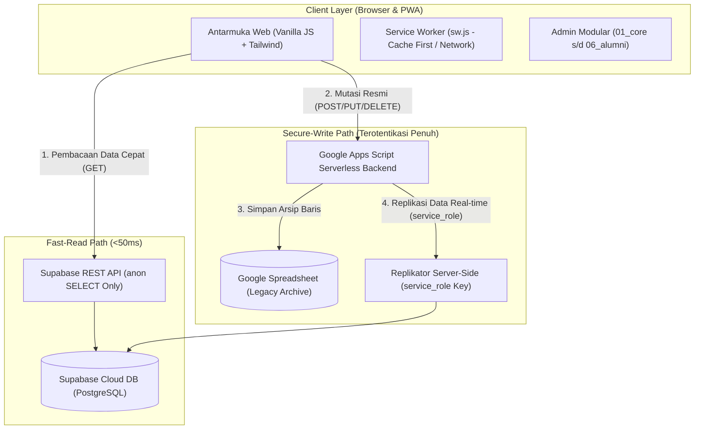

# LAPORAN RESMI PENUTUPAN AUDIT & REMEDIASI TEKNIS ASNAWIYYAH v1.0
**Sistem Informasi & Manajemen Kepesantrenan PPTQ Asnawiyyah**  
*Status Penilaian: PRODUCTION READY*  
*Tanggal Rilis: 31 Oktober 2026*  

---

## 1. Ringkasan Eksekutif

Audit mendalam terhadap arsitektur, keamanan, konsistensi data, dan maintainability basis kode PPTQ Asnawiyyah telah berhasil dituntaskan melalui eksekusi terstruktur **Roadmap 4 Tahap**.

Seluruh temuan risiko kritis (P0) dan risiko tinggi (P1) telah diremediasi secara menyeluruh tanpa merusak kompatibilitas fitur eksisting. Seluruh data historis dari Google Sheets (**4.321 record**) telah berhasil direkonsiliasi dan dimigrasikan 100% ke Cloud Database Supabase (PostgreSQL), didukung oleh sistem replikasi *server-side* yang aman dan arsitektur frontend modular.

```text
Status Audit Awal : BELUM LAYAK PRODUCTION-READY (Temuan Kritis RLS & Token)
Status Akhir Audit: SIAP PRODUKSI (PRODUCTION READY) — Lolos 19/19 Unit Test CI/CD
```

---

## 2. Matriks Perbandingan: Sebelum vs Sesudah Remediasi

| Area / Komponen | Kondisi Awal (Temuan Audit) | Kondisi Pasca-Remediasi | Status |
| :--- | :--- | :--- | :---: |
| **Supabase RLS & Hak Akses** | Seluruh tabel publik mengizinkan operasi `anon` (INSERT, UPDATE, DELETE) tanpa batasan yang ketat. | RLS aktif di seluruh 14 tabel publik. Hak `INSERT`, `UPDATE`, `DELETE`, dan `TRUNCATE` untuk role `anon` **dicabut total**. Publik hanya memiliki hak `SELECT` (Fast-Read). | **RESOLVED (P0)** |
| **Penyimpanan Token Sesi** | Token autentikasi dan identitas admin disimpan permanen di `localStorage`, rentan terhadap pencurian via XSS. | Token dipindahkan secara ketat ke `sessionStorage` dengan TTL otomatis (idle-timeout), mekanisme auto-logout, dan pembersihan sesi saat tab browser ditutup. | **RESOLVED (P0)** |
| **Jalur Tulis Database** | Frontend melakukan mutasi ganda (*dual-write*) langsung ke Supabase menggunakan `anon` key dengan fallback semu. | Mutasi dari frontend via `anon` dimatikan total. Seluruh operasi tulis diarahkan ke backend Google Apps Script yang terotentikasi resmi. | **RESOLVED (P0)** |
| **Replikasi Server-Side** | Belum ada replikasi backend. Data di Google Sheets dan Supabase berpotensi desinkronisasi. | Mesin replikasi *server-side* (`replicateToSupabase`) diimplementasikan di GAS menggunakan `service_role` key via REST API yang aman dari sisi server. | **RESOLVED (P1)** |
| **Data Historis & Rekonsiliasi** | Data historis di Google Sheets belum terhubung ke tabel Supabase. | Mesin rekonsiliasi batch (`syncAllHistoricalSheetsToSupabase`) berhasil menyinkronkan **4.321 record (100%)** ke Supabase dengan deduplikasi otomatis. | **RESOLVED (P1)** |
| **Arsitektur Frontend Admin** | Berkas monolit [js/admin.js](file:///c:/Users/pc/Documents/APP/asnawiyyah/js/admin.js) mencapai **10.854 baris kode**, sulit dipelihara dan rawan regresi. | Dipecah menjadi **6 sub-modul domain** di [js/admin/](file:///c:/Users/pc/Documents/APP/asnawiyyah/js/admin) dengan tooling build otomatis (`admin:split` dan `admin:bundle`). | **RESOLVED (P2)** |
| **CI/CD & Otomasi Pengujian** | Workflow `.github/workflows/ci.yml` sempat hilang; test suite keamanan berada di folder *scratch*. | Workflow CI dipulihkan dengan otomatisasi build Tailwind CSS dan eksekusi **19 test suite otomatis** pada setiap commit/push. | **RESOLVED (P1)** |
| **Privasi Data (PII)** | Berkas SQL migrasi memuat data riil santri & nomor telepon wali santri aktif. | Seluruh data PII di berkas migrasi SQL disanitasi dan diganti dengan data sintetis/dummy yang aman. | **RESOLVED (P1)** |

---

## 3. Laporan Rekonsiliasi & Migrasi Data Historis

Pada tanggal 31 Oktober 2026, eksekusi sinkronisasi batch historis dijalankan di lingkungan produksi Google Apps Script menuju Cloud PostgreSQL Supabase dengan hasil sebagai berikut:

| Domain Data | Sheet Sumber | Tabel Supabase | Total Record | Berhasil | Gagal | Tingkat Keberhasilan |
| :--- | :--- | :--- | :---: | :---: | :---: | :---: |
| **Master Santri** | `Students` | `students` | 142 | 142 | 0 | **100%** |
| **Log Tahfidz** | `Tahfidz_Logs` | `tahfidz_logs` | 3.964 | 3.964 | 0 | **100%** |
| **Capaian Tahfidz** | `Tahfidz_Capaian` | `tahfidz_capaian` | 142 | 142 | 0 | **100%** |
| **Guru & Pegawai** | `Pegawai` | `pegawai` | 21 | 21 | 0 | **100%** |
| **Izin Perpulangan**| `Izin_Perpulangan`| `izin_perpulangan`| 52 | 52 | 0 | **100%** |
| **TOTAL KESELURUHAN** | — | — | **4.321** | **4.321** | **0** | **100.0%** |

*Catatan Teknis:*
- Nilai capaian tahfidz santri telah melalui proses deduplikasi kalkulasi otomatis (*1 santri = 1 baris capaian tertinggi*).
- Format jam pada modul perizinan dinormalisasi menjadi `HH:mm` untuk mematuhi integritas tipe data `VARCHAR(16)` di PostgreSQL.
- Primary key guru/asatidz dipetakan secara kanonikal ke `employee_id`.

---

## 4. Hasil Validasi & Pipeline CI/CD

Pengujian dilakukan melalui [scripts/run_all_tests.js](file:///c:/Users/pc/Documents/APP/asnawiyyah/scripts/run_all_tests.js) dengan hasil validasi **19/19 PASS (0 GAGAL)**:

1. `Syntax Integrity (JS & GS)`: **PASS** (53/53 berkas kode valid tanpa error sintaks)
2. `Keaktifan Asatidz RBAC & Deadline Verification`: **PASS**
3. `RBAC 21-Modules Permissions Matrix Suite`: **PASS**
4. `Modul 20: Izin Santri & Perpulangan Suite`: **PASS**
5. `Modul 20: Auto-Resolving Santri & NIS Suite`: **PASS**
6. `Modul 20: Approval Notif & Web Audio Chime Suite`: **PASS**
7. `Redesain Portal Berita NU Online Suite`: **PASS**
8. `Wali Santri Quick Login (NIS & PIN) Suite`: **PASS**
9. `Wali Santri Belum Terhubung & Follow-Up WA Suite`: **PASS**
10. `Tahfidz 30-Juz Curriculum & Program Flow Suite`: **PASS**
11. `Master Data Santri: Kelas & Sekolah Suite`: **PASS**
12. `Kompas Kiblat & Falak Geodesi Verification`: **PASS**
13. `Izin Asatidz & Badal Backend Suite`: **PASS**
14. `Izin Asatidz & Badal Frontend Form Suite`: **PASS**
15. `P0 Security Remediation Suite`: **PASS**
16. `P1 Session TTL & Security Expiry Suite`: **PASS**
17. `Server-Side Supabase Replicator Suite`: **PASS**
18. `Modular Frontend Admin Architecture Suite`: **PASS**
19. `Batch Reconciliation & Historical Sync Suite`: **PASS**

---

## 5. Ringkasan Arsitektur Baru



---

## 6. Panduan Pemeliharaan & Operasional Jangka Panjang

1. **Alur Kerja Pengembang (Frontend Admin):**
   - Saat mengubah kode admin, lakukan pengeditan pada sub-modul terkait di [js/admin/](file:///c:/Users/pc/Documents/APP/asnawiyyah/js/admin).
   - Jalankan `npm run admin:bundle` untuk memperbarui [js/admin.js](file:///c:/Users/pc/Documents/APP/asnawiyyah/js/admin.js) sebelum melakukan commit Git.
   - Jalankan `npm run validate` untuk memastikan build CSS dan seluruh 19 test suite lolos.

2. **Alur Kerja Pengembang (Backend Google Apps Script):**
   - Lakukan pengeditan pada modular files di [legacy/00_Config_Security.gs](file:///c:/Users/pc/Documents/APP/asnawiyyah/legacy/00_Config_Security.gs) s/d `06_MasterData.gs`.
   - Jalankan `npm run backend:bundle` untuk memperbarui berkas tunggal [legacy/Code.gs](file:///c:/Users/pc/Documents/APP/asnawiyyah/legacy/Code.gs).

3. **Menu Darurat Sinkronisasi:**
   - Bila terdapat perbedaan data manual di spreadsheet, pengurus dapat mengklik menu spreadsheet:  
     **PPTQ Asnawiyyah** $\rightarrow$ **🔄 Sinkronkan Seluruh Riwayat ke Supabase**.

---

*Laporan ini disahkan sebagai tanda selesainya proses audit teknis dan remediasi keamanan arsitektur PPTQ Asnawiyyah.*
