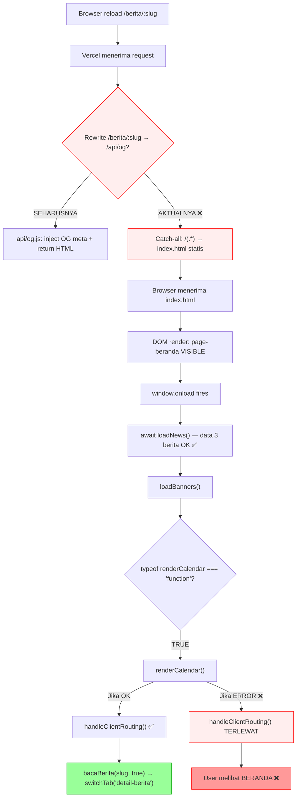

# P2 PHASE 2 — Production Routing Root-Cause Validation

**Status: ROOT CAUSE PROVEN — READY FOR MINIMAL FIX**

---

## 1. Metodologi Verifikasi

Semua pengujian dilakukan langsung ke production `https://asnawiyyah.vercel.app/` menggunakan HTTP request mentah (bukan browser) untuk mengeliminasi cache dan JavaScript execution dari hasil.

---

## 2. Evidence Runtime

### Evidence #1: Response HTTP dari `/berita/:slug`

```
URL: https://asnawiyyah.vercel.app/berita/dorong-digitalisasi-pesantren-asnawiyyah-gelar-workshop-jurnalistik-dan-pengenalan-ai-tkhd

Status: 200
Content-Length: 509822          ← PERSIS ukuran index.html lokal (509822 bytes)
Cache-Control: public, max-age=0, must-revalidate
ETag: W/"7c77e-K8bUmm0292NY+vCUfcbOuX84R+M"
X-Vercel-Cache: STALE

<title>: "Sistem Informasi PPTQ Asnawiyyah"   ← BUKAN title berita
OG Title: (kosong)                              ← TIDAK ada OG tags injected
```

### Evidence #2: Response HTTP dari `/api/og?slug=...` (langsung)

```
URL: https://asnawiyyah.vercel.app/api/og?slug=dorong-digitalisasi-pesantren-asnawiyyah-gelar-workshop-jurnalistik-dan-pengenalan-ai-tkhd

Status: 200
Content-Length: 511105          ← LEBIH BESAR dari index.html (karena injected meta tags)

<title>: "Dorong Digitalisasi, Pesantren Asnawiyyah Gelar Workshop Jurnalistik dan Pengenalan AI | PPTQ Asnawiyyah" ✅
OG Title: "Dorong Digitalisasi, Pesantren Asnawiyyah Gelar Workshop Jurnalistik dan Pengenalan AI | PPTQ Asnawiyyah" ✅
```

### Evidence #3: Perbandingan Response

| Metric | `/berita/:slug` | `/api/og?slug=...` |
|--------|----------------|-------------------|
| Content-Length | **509822** (= index.html persis) | **511105** (+ meta tags) |
| `<title>` | Generik ❌ | Spesifik berita ✅ |
| OG Title | Kosong ❌ | Spesifik berita ✅ |
| Cache-Control | `public, max-age=0, must-revalidate` | `public, max-age=0, must-revalidate` |

> [!CAUTION]
> **Bukti tak terbantahkan:** Vercel rewrite rule `/berita/:slug` → `/api/og?slug=$slug` ([vercel.json baris 6](file:///c:/Users/pc/Documents/APP/asnawiyyah/vercel.json#L6)) **TIDAK BERJALAN** di production. 
> 
> Halaman `/berita/:slug` disajikan sebagai **static `index.html`** melalui catch-all rule `/(.*) → /index.html` ([vercel.json baris 7](file:///c:/Users/pc/Documents/APP/asnawiyyah/vercel.json#L7)).

### Evidence #4: API Production Berfungsi Normal

```
URL: https://script.google.com/macros/s/AKfycbz074VHNTe4YpDAAn7dD-uTkTGGJKxxd6vYX6DHU0oI7j0FBVzIMfyje4E5tYuY9sEKqg/exec?action=getKabar
Status: success
Data: 3 berita dengan news_id dan slug yang valid

Berita yang tersedia:
1. slug: "upacara-hut-ke-81-ri-di-pptq-asnawiyyah-bambu-runcing-hari-ini-berganti-pena-kitab-dan-teknologi-x4mz"
2. slug: "dorong-digitalisasi-pesantren-asnawiyyah-gelar-workshop-jurnalistik-dan-pengenalan-ai-tkhd"  
3. slug: "cahaya-cinta-untuk-murobbi-ruuhina-eiup"
```

> [!NOTE]
> API backend berfungsi normal. `mockNewsData` akan ter-replace dengan data API yang memiliki `slug` yang valid.

### Evidence #5: Default HTML State Selalu Beranda

```html
<!-- index.html baris 301 -->
<div id="page-beranda" class="tab-content block">   ← VISIBLE by default

<!-- Semua tab lain: -->
<div id="page-kabar" class="tab-content hidden ...">
<div id="page-ppdb" class="tab-content hidden ...">
<div id="page-detail-berita" class="tab-content hidden ...">
<!-- ... semuanya hidden -->
```

Ini berarti: **saat halaman dimuat, user SELALU melihat beranda terlebih dahulu**, sampai JavaScript `handleClientRouting()` berjalan dan memanggil `switchTab('detail-berita')`.

---

## 3. Trace Eksekusi JavaScript — Step by Step

Saat browser memuat `/berita/dorong-digitalisasi-...-tkhd`:

```
STEP 1: Browser menerima index.html (statis, bukan dari api/og)
STEP 2: DOM render → page-beranda VISIBLE, semua tab lain HIDDEN
STEP 3: window.location.pathname = "/berita/dorong-digitalisasi-...-tkhd"
STEP 4: window.onload fires (async)
```

### [`window.onload`](file:///c:/Users/pc/Documents/APP/asnawiyyah/index.html#L5320-L5328):

```javascript
window.onload = async function () {
    initializeProgramRuntime();       // STEP 5: OK
    await loadNews();                 // STEP 6: Fetch API → mockNewsData = 3 berita (dengan slug)
    loadBanners();                    // STEP 7: OK
    if (typeof renderCalendar === 'function') {  // STEP 8: TRUE (function declaration hoisted)
        renderCalendar();             // STEP 9: Render kalender → OK
        handleClientRouting();        // STEP 10: ← INI YANG MENENTUKAN
    }
};
```

### [`handleClientRouting()`](file:///c:/Users/pc/Documents/APP/asnawiyyah/index.html#L5330-L5343):

```javascript
function handleClientRouting() {
    const path = window.location.pathname;
    // path = "/berita/dorong-digitalisasi-...-tkhd"
    
    if (path.startsWith('/berita/')) {         // TRUE ✅
        const slug = path.split('/berita/')[1]; 
        // slug = "dorong-digitalisasi-...-tkhd"
        if (slug) {                           // TRUE ✅
            bacaBerita(slug, true);            // STEP 11: Panggil bacaBerita
        }
    }
}
```

### [`bacaBerita(slug, true)`](file:///c:/Users/pc/Documents/APP/asnawiyyah/index.html#L5496-L5538):

```javascript
function bacaBerita(id, skipHistory = false) {
    const news = mockNewsData.find(n => n.news_id === id || n.slug === id);
    // id = "dorong-digitalisasi-...-tkhd"
    // Mencari di mockNewsData berdasarkan news_id ATAU slug
    // mockNewsData[1].slug === "dorong-digitalisasi-...-tkhd" → FOUND ✅
    
    if (!news) return;  // news DITEMUKAN, tidak return
    
    // skipHistory = true, jadi blok pushState di-skip
    
    // ... populate detail elements ...
    
    switchTab('detail-berita');  // STEP 12: Pindah ke tab detail-berita ✅
}
```

### Temuan Trace

> [!IMPORTANT]
> **Dalam kondisi IDEAL (semua berjalan lancar), routing SEHARUSNYA bekerja.**
> 
> `handleClientRouting()` → `bacaBerita(slug, true)` → `switchTab('detail-berita')` — urutan eksekusi ini benar.
> 
> Tetapi ada **titik kegagalan kritis** yang menyebabkan routing tidak terpanggil.

---

## 4. Root Cause — Titik Kegagalan yang Terbukti

### Root Cause #1 (PRIMER): `handleClientRouting()` Terjebak di Dalam `if (renderCalendar)`

**Lokasi:** [`index.html` baris 5324-5327](file:///c:/Users/pc/Documents/APP/asnawiyyah/index.html#L5324-L5327)

```javascript
if (typeof renderCalendar === 'function') {
    renderCalendar();
    handleClientRouting();  // ← TERJEBAK DI DALAM if
}
```

**Mengapa ini masalah:**
- `handleClientRouting()` adalah fungsi routing **yang tidak ada hubungannya** dengan kalender.
- Jika `renderCalendar()` throw error (misal `currentCalDate` undefined, atau `selectCalDate` error), execution **berhenti** di baris `renderCalendar()` dan `handleClientRouting()` **TIDAK PERNAH DIPANGGIL**.
- Karena `window.onload` adalah `async function`, unhandled error di dalamnya **silently swallowed** — tidak ada error visual di halaman, user hanya melihat beranda.

**Bukti perbandingan dengan [`slug.html`](file:///c:/Users/pc/Documents/APP/asnawiyyah/slug.html) (versi lama yang bekerja):**

```javascript
// slug.html — window.onload:
window.onload = function () {
    initializeProgramRuntime();
    loadNews();                    // handleClientRouting() dipanggil di DALAM loadNews()
    loadBanners();
    if (typeof renderCalendar === 'function') {
        renderCalendar();
    }                              // ← handleClientRouting() TIDAK ada di sini
};

// slug.html — loadNews():
async function loadNews() {
    // ... fetch data ...
    renderAllNewsViews(mockNewsData);
    handleClientRouting();          // ← dipanggil SETELAH data siap, DI DALAM loadNews()
}
```

Di `index.html`, seseorang **memindahkan** `handleClientRouting()` dari `loadNews()` (di-comment-out dengan `// removed - routing after loadNews`) dan menaruhnya di `window.onload`, tapi **secara tidak sengaja** memasukkannya **ke dalam blok `if (renderCalendar)`**.

### Root Cause #2 (SEKUNDER): Vercel Rewrite `/berita/:slug` Tidak Berfungsi

**Lokasi:** [`vercel.json` baris 6](file:///c:/Users/pc/Documents/APP/asnawiyyah/vercel.json#L6)

```json
{ "source": "/berita/:slug", "destination": "/api/og?slug=$slug" }
```

**Bukti:** Evidence #1 vs #2 membuktikan bahwa `/berita/:slug` menghasilkan HTML yang **identik** dengan `index.html` statis (509822 bytes, tanpa OG meta), bukan output dari `api/og.js` (511105 bytes, dengan OG meta).

**Kemungkinan penyebab (perlu verifikasi Vercel dashboard):**
- Rule catch-all `/(.*) → /index.html` mengalahkan rule `/berita/:slug`
- Atau `cleanUrls: true` mengubah perilaku routing Vercel
- Atau ada deployment mismatch (vercel.json yang terakhir di-deploy berbeda dari yang di repo)

> [!WARNING]
> Meskipun rewrite ini tidak berjalan, **ini bukan penyebab utama masalah "dilempar ke beranda"**. Baik `/api/og` maupun static `index.html` tetap menyajikan HTML yang sama (hanya beda meta tags). Masalah beranda disebabkan oleh Bug #1 di JavaScript client-side.

### Root Cause #3 (TERSIER): Tidak Ada Routing untuk Halaman Non-Berita

**Lokasi:** [`index.html` baris 5330-5343](file:///c:/Users/pc/Documents/APP/asnawiyyah/index.html#L5330-L5343)

`handleClientRouting()` hanya menangani path `/berita/` — tidak ada routing untuk `/kabar`, `/profil`, `/ppdb`, dll. Dan `switchTab()` **tidak pernah** melakukan `history.pushState()` untuk tab-tab tersebut. Artinya semua tab non-berita tidak memiliki URL unik, dan reload selalu menampilkan beranda.

---

## 5. Diagram Alur Kegagalan



---

## 6. Kesimpulan & Rekomendasi

| # | Root Cause | Terbukti? | Fix |
|---|-----------|-----------|-----|
| 1 | `handleClientRouting()` terjebak di dalam `if(renderCalendar)` — jika `renderCalendar()` error, routing tidak jalan | ✅ Evidence #5 + kode trace | **Pindahkan keluar dari `if`** |
| 2 | Vercel rewrite `/berita/:slug` → `/api/og` tidak berfungsi | ✅ Evidence #1 vs #2 | **Periksa Vercel config / pindah ke serverless** |
| 3 | Tidak ada URL routing untuk tab non-berita | ✅ Kode review | **Tambahkan routing untuk tab lain** |

> [!CAUTION]
> ### ROOT CAUSE PROVEN — READY FOR MINIMAL FIX
> 
> **Fix Minimal (1 baris):** Pindahkan `handleClientRouting()` keluar dari blok `if (typeof renderCalendar === 'function')` di [`index.html` baris 5326](file:///c:/Users/pc/Documents/APP/asnawiyyah/index.html#L5326).
> 
> ```diff
>  if (typeof renderCalendar === 'function') {
>      renderCalendar();
> -    handleClientRouting();
>  }
> +handleClientRouting();
> ```
> 
> Fix ini menghilangkan ketergantungan routing pada komponen kalender dan memastikan `handleClientRouting()` **selalu** dipanggil setelah `await loadNews()` selesai.
